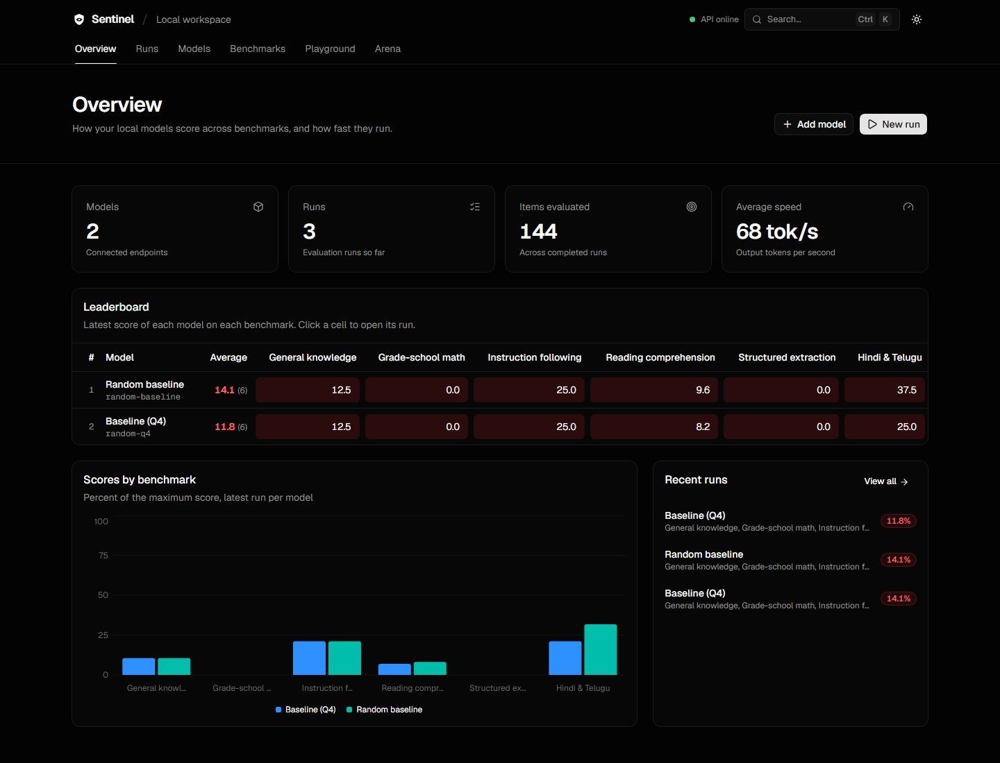
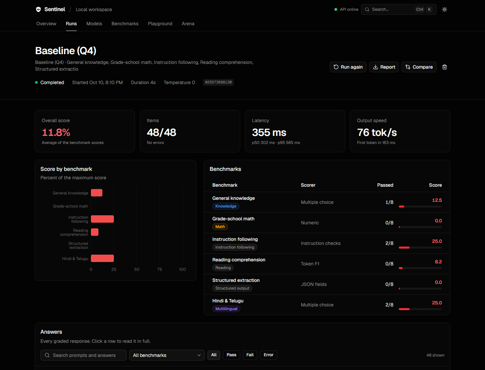
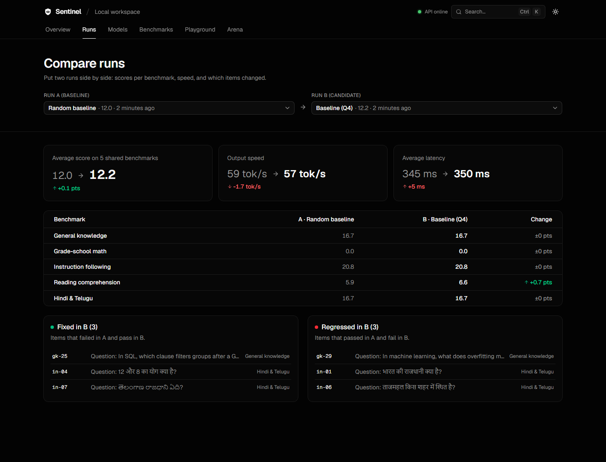
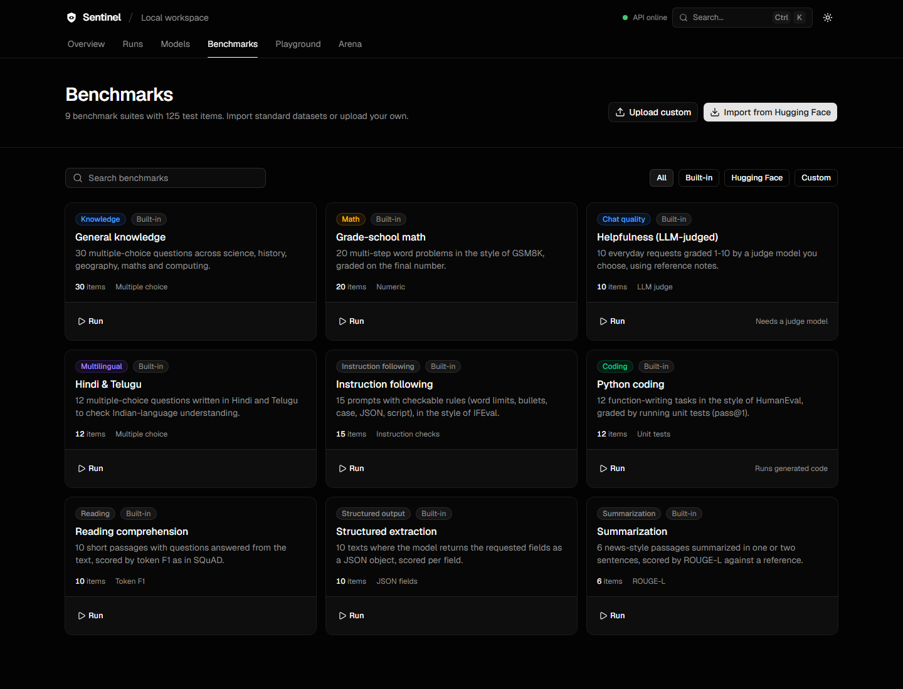
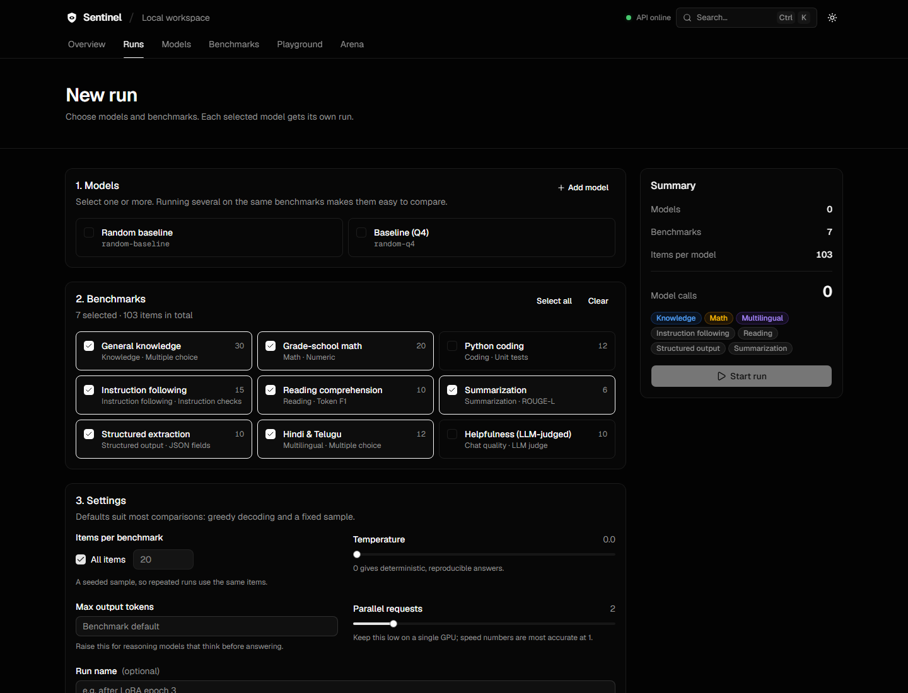
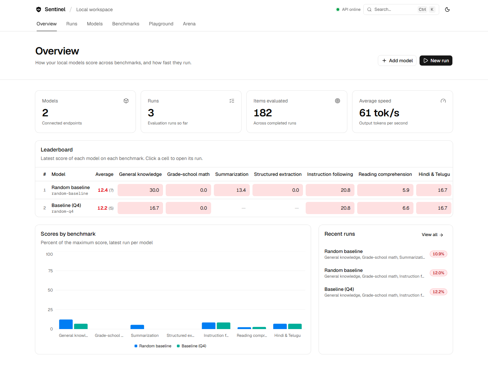
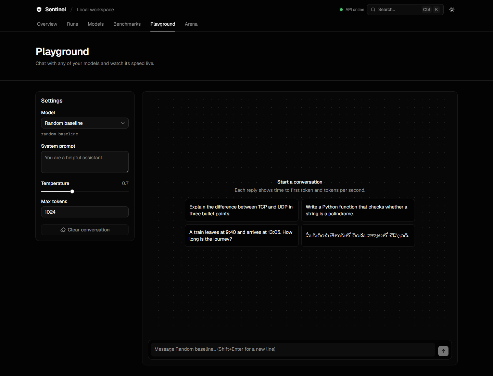
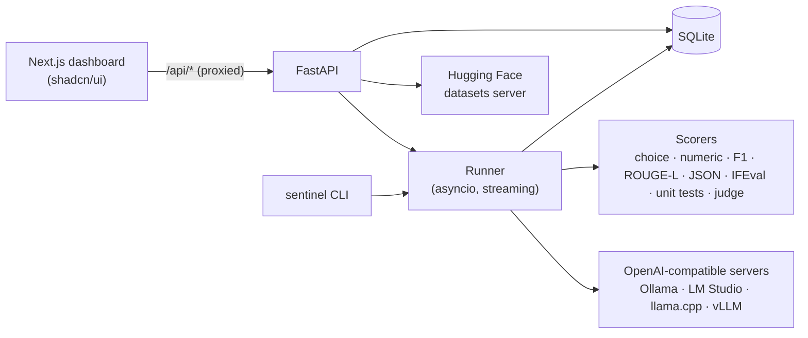

# Sentinel

**Evaluate and benchmark the LLMs you run locally.** Point Sentinel at any OpenAI-compatible
server (Ollama, LM Studio, llama.cpp, vLLM, Jan) and get benchmark scores, speed measurements,
side-by-side comparisons and a blind arena, all in one dashboard.



## Features

- **Benchmarks.** Nine built-in suites cover knowledge, maths, Python coding, instruction following,
  reading comprehension, summarization, structured JSON output, Hindi & Telugu, and LLM-judged
  helpfulness. Import **MMLU, GSM8K, ARC-Challenge, HellaSwag, TruthfulQA, BoolQ, HumanEval and MBPP**
  from Hugging Face in one click, or upload your own test set as JSONL.
- **Ten scorers.** Multiple choice, numeric, exact match, contains, token F1 (SQuAD), ROUGE-L, JSON
  fields, IFEval-style instruction checks, unit tests (pass@1), and an LLM judge.
- **Speed.** Every answer is streamed, so each run reports latency (avg, p50, p95), time to first
  token and output tokens per second. A warm-up request runs first, so model load time doesn't skew
  the numbers and an unreachable server fails the run immediately.
- **Honest numbers.** Every benchmark score comes with a 95% confidence interval, so you can tell a
  real improvement from noise on small samples.
- **Runs and comparison.** Evaluate several models at once, then compare any two runs: score change
  per benchmark, speed change, and exactly which items got fixed or regressed.
- **Leaderboard.** A model-by-benchmark heatmap of the latest scores.
- **Playground.** Chat with any model and watch its speed live.
- **Arena.** Blind A/B battles. Your votes become Elo ratings, the method behind Chatbot Arena.
- **CLI and CI gate.** `sentinel run ... --fail-below 0.6` exits non-zero when a checkpoint regresses.
- **Reasoning models.** Thinking from models like Qwen3 and DeepSeek-R1 is kept out of grading,
  shown in a collapsible block in the playground, and flagged when the token limit cuts it off.
- **Export.** Download any run as a Markdown report or a CSV of every answer.
- **Resilient.** Transient server errors (connection drops, 429, 5xx) are retried with backoff.
- **Works offline.** A built-in random baseline lets you try everything without a model server, and
  shows the chance-level score of each benchmark.

| Run detail | Compare runs |
|---|---|
|  |  |
| **Benchmarks** | **New run** |
|  |  |
| **Light theme** | **Playground** |
|  |  |

## Quick start

Requirements: Python 3.11+, Node.js 20+ and pnpm.

```bash
# 1. API (port 8765)
cd backend
python -m venv .venv
.venv/Scripts/activate        # Windows; on macOS/Linux: source .venv/bin/activate
pip install -e ".[dev]"
sentinel serve

# 2. Dashboard (port 3000), in a second terminal
cd web
pnpm install
pnpm dev
```

Open http://localhost:3000. If a model server is running, the **Models** page detects it and lists
its models; click one to add it. No server yet? Add the **random baseline** to explore the app.

### Connecting a local model

| Server | Base URL | Start it with |
|---|---|---|
| Ollama | `http://localhost:11434/v1` | `ollama serve`, then `ollama pull llama3.2` |
| LM Studio | `http://localhost:1234/v1` | Developer tab → Start server |
| llama.cpp | `http://localhost:8080/v1` | `llama-server -m model.gguf` |
| vLLM | `http://localhost:8000/v1` | `vllm serve <model>` |
| Jan | `http://localhost:1337/v1` | Settings → Local API server |

### Laptops and reasoning models

Sentinel was tested end to end on a 16 GB laptop (i5-1135G7, 2 GB GeForce MX450) running
`deepseek-r1:8b` (Q4_K_M) through Ollama. What worked:

- **Cap Ollama's memory** with environment variables, then restart Ollama:
  `OLLAMA_CONTEXT_LENGTH=4096`, `OLLAMA_NUM_PARALLEL=1`, `OLLAMA_MAX_LOADED_MODELS=1`,
  `OLLAMA_FLASH_ATTENTION=1`, `OLLAMA_KV_CACHE_TYPE=q8_0`.
- **Use a small GPU for memory, not speed.** On a 2 GB card Ollama offloads nothing by default.
  Pinning a few layers (`PARAMETER num_gpu 8` in a Modelfile) gave the same ~4.5 tokens/s but left
  about 1 GB more system RAM free.
- **Give reasoning models room to think.** R1-style models write hundreds of reasoning tokens before
  answering, so the built-in suites' default limits cut them off. Set **Max output tokens** to 2048 or
  more; Sentinel flags every answer that hit the limit.
- **Keep runs small.** At ~4.5 tokens/s a reasoning answer takes 1–8 minutes, so start with 1–2 items
  per benchmark and one parallel request.

Any other OpenAI-compatible endpoint works too. If it needs a key, set it in an environment variable
on the backend and enter that variable's **name** in the model form. Keys are never stored.

## Benchmarks

| Suite | Category | Items | Scorer |
|---|---|---:|---|
| General knowledge | Knowledge | 30 | Multiple choice |
| Grade-school math | Math | 20 | Numeric (GSM8K style) |
| Python coding | Coding | 12 | Unit tests (HumanEval style) |
| Instruction following | Instruction | 15 | IFEval-style checks |
| Reading comprehension | Reading | 10 | Token F1 |
| Summarization | Summarization | 6 | ROUGE-L |
| Structured extraction | Structured output | 10 | JSON fields |
| Hindi & Telugu | Multilingual | 12 | Multiple choice |
| Helpfulness | Chat quality | 10 | LLM judge |

The built-in suites are small so they run in a minute or two on a laptop. For leaderboard-grade
numbers, import the standard datasets (Benchmarks → Import from Hugging Face) with a sample size of a
few hundred. Multiple-choice answers are spread evenly across the letters, so a model that always
picks the same letter scores about 25%.

### Custom benchmarks

Upload JSONL (one object per line) on the Benchmarks page:

```jsonl
{"input": "Which planet is largest?", "choices": ["Mars", "Jupiter", "Venus"], "target": "B"}
{"input": "What is 17 * 3?", "target": "51"}
{"input": "Extract name and age: Asha, 31", "target": {"name": "Asha", "age": 31}}
{"input": "Describe tea in 2 bullets.", "constraints": [{"type": "num_bullets", "value": 2}]}
```

The prompt template can use `{input}`, `{context}` and `{choices}`. Built-in suites are generated
from [`backend/scripts/build_suites.py`](backend/scripts/build_suites.py).

### Coding benchmarks run generated code

Coding suites execute model-written Python on your machine in a separate process with a time limit.
That stops hangs and crashes, but it is **not a security sandbox**, so it is off until you allow it
for a run (a checkbox in the UI, `--allow-code-exec` on the CLI).

## CLI

```bash
sentinel discover                                   # find local model servers
sentinel import gsm8k --limit 200                   # import a Hugging Face benchmark
sentinel suites                                     # list benchmark suites
sentinel run --endpoint http://localhost:11434/v1 --model-id llama3.2 \
  --suites general-knowledge,grade-school-math --limit 20 --markdown report.md
sentinel run --model "my-finetune" --fail-below 0.6 # exit 1 if the score drops below 60%
```

Runs from the CLI are stored in the same database, so they appear in the dashboard.

## How it works



| Path | Contents |
|---|---|
| `backend/sentinel/models.py` | Data contracts (mirrored in `web/src/lib/types.ts`) |
| `backend/sentinel/providers.py` | Streaming OpenAI-compatible client, server discovery, random baseline |
| `backend/sentinel/scorers.py` | All scorers, including the code runner and LLM judge |
| `backend/sentinel/runner.py` | Run execution and summaries (scores, latency percentiles, tokens/s) |
| `backend/sentinel/hub.py` | Hugging Face benchmark import |
| `backend/sentinel/arena.py` | Blind battles and Elo ratings |
| `backend/sentinel/api.py` | REST API under `/api` |
| `web/src/app` | Dashboard pages (Next.js 16 App Router) |

Configuration: `SENTINEL_DB` sets the SQLite path (default `./sentinel.db`) and `SENTINEL_API_URL`
tells the dashboard where the API is (default `http://127.0.0.1:8765`).

## Development

```bash
cd backend && pytest -q          # backend tests
cd web && pnpm lint && pnpm build
```

## Roadmap

- pass@k with multiple samples
- Few-shot prompting and chat templates per benchmark
- RAG evaluation (faithfulness and context relevance)
- GPU and memory monitoring during runs
- Docker Compose setup

## License

MIT
